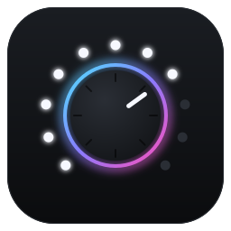
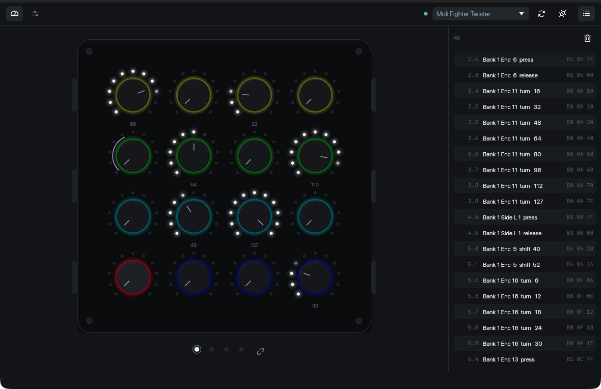
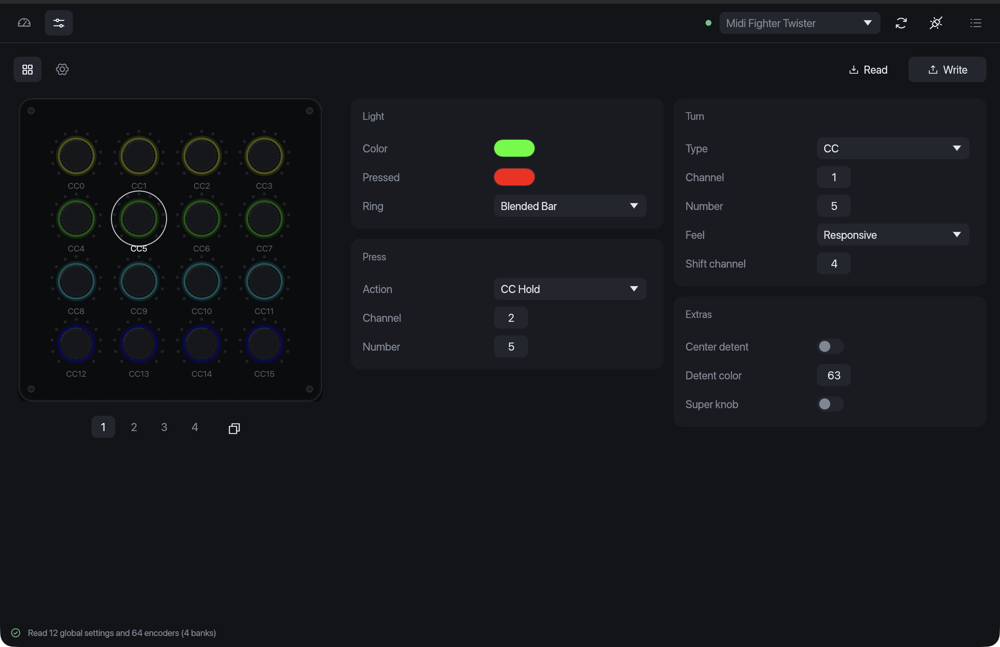

<p align="center">
  
</p>

<h1 align="center">Sixteen</h1>

<p align="center">
  Sixteen knobs, all yours. A small native monitor and configuration editor for the
  <a href="https://www.midifighter.com/#Twister">Midi Fighter Twister</a>: watch every knob, press and
  side button live, and edit the settings stored on the device.
</p>

## What it does

**Monitor**

<p align="center">
  
</p>

- Draws the Twister as it looks: 16 encoders, each with an 11-LED ring and an RGB glow, and 3 side buttons on each side.
- Turning a knob fills its ring. Pressing it lights the cap, and the shift layer shows as a thin inner arc.
- Once you've read the configuration, each cap glows in its configured color.
- Follows the bank the device is on, or you can pin any of the 4 banks.
- An optional MIDI log shows every message, decoded.

**Configure**

<p align="center">
  
</p>

- Reads the global settings and all 64 encoders from the device over SysEx. It does this automatically the first time you open the page.
- Edits each encoder's colors, ring style, rotary and button MIDI settings, detent and super knob.
- Edits global settings: channels, brightness, palette, sleep, the side-button actions, detent and dead-zone size.
- **Copy to whole bank** gives the other 15 encoders the same settings and keeps each one's MIDI numbers.
- Changes show in amber until you **Write** them to the Twister.
- Settings the app doesn't recognize are kept and written back unchanged.

## Build and run

Requires Rust 1.85 or later (edition 2024).

```sh
cargo run --release
```

The app looks for a MIDI input whose name contains "Twister" and connects to it automatically.
It has only been built and run on macOS. It uses SF Pro and SF Mono when they're available and
falls back to egui's bundled fonts otherwise.

To show the demo state used for the screenshots, with a mocked log and settings and no device needed:

```sh
SIXTEEN_DEMO=monitor cargo run --release     # or SIXTEEN_DEMO=configure
```

For a smaller binary (about 6.5 MB instead of about 15 MB):

```sh
CARGO_PROFILE_RELEASE_STRIP=true CARGO_PROFILE_RELEASE_LTO=true \
CARGO_PROFILE_RELEASE_CODEGEN_UNITS=1 CARGO_PROFILE_RELEASE_OPT_LEVEL=s \
CARGO_PROFILE_RELEASE_PANIC=abort cargo build --release
```

## How the configuration protocol was found

The Twister's configuration protocol isn't documented. It was worked out from DJ TechTools'
Midi Fighter Utility, for interoperability, using [REA](https://github.com/morluto/rea) and
`objdump`. The Utility's device plugin describes every setting, and its native code frames the
SysEx messages. The full write-up is in [`research/PROTOCOL.md`](research/PROTOCOL.md). In short,
every message is `F0 00 01 79 … F7`. The global settings are a list of tag/value pairs, and each
encoder is a 32-byte record sent in chunks of up to 24 bytes.

The repository doesn't include the Utility itself or anything extracted from it, apart from the
setting tables and LED palettes the app needs.

## Project layout

| Path | What it is |
|------|------------|
| `src/twister.rs` | Decodes the default MIDI map (knobs, presses, banks, side buttons, shift) |
| `src/protocol.rs` | Builds and parses the configuration SysEx messages, with tests |
| `src/config.rs` | Setting tables: tags, ranges and options |
| `src/worker.rs` | Background read and write over MIDI |
| `src/knob.rs` | Drawing of the hardware |
| `src/config_ui.rs` | The Configure page |
| `src/theme.rs` | Colors, fonts, icons |
| `src/demo.rs` | Mocked state for screenshots (`SIXTEEN_DEMO`) |
| `research/PROTOCOL.md` | Protocol notes |

## Thank you

Thank you to **[DJ TechTools](https://djtechtools.com)** for making the Midi Fighter Twister.
It's an awesome device, solid and endlessly mappable, and this app exists because it's so much
fun to use.

Icons are from [Phosphor Icons](https://phosphoricons.com) (MIT). Their license is in
`assets/fonts/Phosphor-LICENSE`. The app is built with [egui](https://github.com/emilk/egui)
and [midir](https://github.com/Boddlnagg/midir).

## License

[MIT](LICENSE). The bundled Phosphor icon font is also MIT; its license is in `assets/fonts/Phosphor-LICENSE`.

## Disclaimers

- **Made with AI.** This project was designed, reverse engineered and written with the help of
  an AI coding assistant (Claude Code). Review the code before you rely on it.
- **Unofficial.** This project isn't affiliated with or endorsed by DJ TechTools. "Midi Fighter"
  and "Midi Fighter Twister" are their trademarks.
- **Use at your own risk.** Reading the configuration has been tested on a real Twister. Writing
  is built from the same protocol analysis. It sends the settings exactly as they were read,
  plus your edits. Use the Midi Fighter Utility to restore factory settings if you ever need to.
